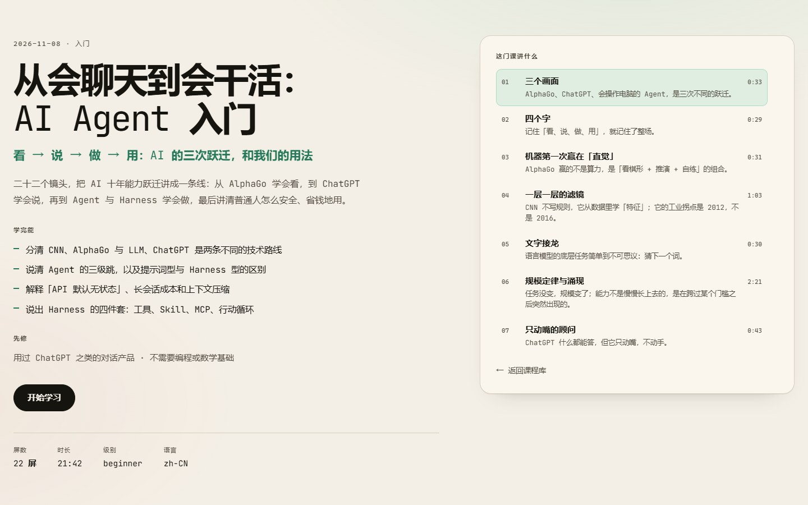

# AI Learning

> 把 AI 讲清楚，一屏一屏地。

AI Learning 是一个用网页动画讲 AI 的教学网站。每一屏只讲一个概念；短课点一下进入下一屏，长视频课程会随旁白自动接续。一门课是一串可以直接在浏览器里播放的动画，而不是一段被锁在播放器里的视频。

当前状态：**v0.4，平台骨架可用，第一门长视频课程已按新版脚本重做**。站点、课程契约、构建流水线、课程外壳、匿名进度和课程 [从会聊天到会干活：AI Agent 入门](courses/ai-first-sees/) 都已经跑通。这门课 22 屏 / 21:42，整门课浅色纸面，旁白驱动动画、字幕在画面底部，播放时像视频一样连续，也可以随时暂停、关字幕、关配音；同一份 composition 可以直接导出 MP4。CI 与部署还没做。

## 为什么要做

AI 教学常见两种形态：长视频和图文。

长视频有过程感，但信息密度低，不能检索，也很难按自己的节奏停下来。图文可以扫读，却很难把“一步推一步”的过程讲清楚。PPT 式的动画更接近我们想要的东西，但大多数实现最终又导出成视频，绕回同一个问题。

网页可以提供第三种形态：文字是真正的文字，动画是真正的网页元素，讲解可以暂停、回看、搜索，也可以被辅助技术读到。它不必变成 MP4。

## 学习体验

一门课从封面开始：

1. **封面**：这门课讲什么、学完能做什么、大概要多久。
2. **一屏**：一个概念、一个动画、一句结论。动画随旁白自动播放，也可以随时暂停；长视频课程会像视频一样自动进入下一屏。
3. **下一页**：由学习者控制节奏。可以重播本屏，也可以打开讲义读文字版。
4. **随时退出**：控制条第一个按钮就是「返回课程库」，学到一半不想看了，不用点完所有屏；离开时会停掉并销毁播放器。
5. **结束**：用几条要点回顾这门课，然后回到课程库。




一屏的结构大致是这样：

```text
┌──────────────────────────────────────┐
│ 03 / 08    token 是什么              │  ← 课程外壳：进度、章节
├──────────────────────────────────────┤
│                                      │
│          HyperFrames composition     │  ← 一屏动画（16:9）
│          一个 scene，一个概念         │
│                                      │
├──────────────────────────────────────┤
│ ← 上一屏      ▶ 暂停      下一屏 →    │  ← 播放控制
└──────────────────────────────────────┘
```

课程页可以脱离网站单独打开：`/courses/<slug>/` 是一个完整的静态页面，自带播放器、素材和课程清单。网站只负责封面、目录和引导。

这里的“独立打开”指独立 HTTP 静态部署，不是双击 HTML 文件。播放器需要在同源 iframe 里注入 runtime，`file://` 的浏览器安全策略不支持这种做法；用任意静态服务器打开即可。

## 六条设计原则

**1. 一屏只讲一件事。**
一屏里出现两个中心概念，就拆成两屏。屏幕不是容器，是节拍。

**2. 动画要承担论证。**
动画用来展示关系、过程、因果和变化。能静下来讲清楚的，就不要让它动。动效不是装饰，不能删掉之后论证还完整。

**3. 先直觉，后术语。**
先让学习者看见一个具体的例子，再给它名字。不要用定义解释定义。

**4. 每一屏都能停下来读。**
关键信息不能只存在于运动里。暂停后要看得懂，讲义里要读得到，屏幕阅读器要读得出。

**5. 课程是独立作品。**
每门课有自己的封面、素材、播放器和 URL。它不依赖网站存在，也不因为网站改版而失效。

**6. 网站退后，课程向前。**
网站是封面和索引，不是套在每门课外面的框架。进入课程之后，界面应该安静下来。

## 设计系统

视觉规则不靠口头约定：完整的前端设计契约写在 **[DESIGN.md](DESIGN.md)**，包括色板与令牌、字阶、版式纪律、组件规范、动效理由、文案标点、课程 composition 的 1920×1080 安全区，以及交付前自检清单。

实现上只有一个来源：`design/tokens.css`。它由 `scripts/sync_runtime.py` 同步到站点和课程外壳；页面 CSS 不允许写死新的颜色、圆角或层级。`tests/test_design_contract.py` 会守住其中可机械检查的部分（令牌同步、界面文案零 em-dash、AGENTS.md 必须引用 DESIGN.md）。

当前设计取向：暖纸色 + 墨色 + 单一锈红强调色的亮色系统，不做深色模式；像一叠印刷品，不像 SaaS 面板。

## 为什么不是 MP4
| | MP4 | 网页动画 |
| --- | --- | --- |
| 文字 | 被编码成像素，缩放会糊 | 真实文字，任意分辨率都清晰 |
| 体积 | 几分钟动辄几十到几百 MB | 通常几 MB，按需加载 |
| 检索 | 只能靠字幕文件 | 标题、正文、讲义都可索引 |
| 交互 | 只能播放、暂停、拖进度 | 可以暂停、重播、跳屏、做练习 |
| 更新 | 改一句话要重新编码 | 改 HTML、重新构建，不必重新编码 |
| 无障碍 | 依赖字幕和音轨 | 语义结构、讲义、键盘操作可以一起做 |

代价也要说清楚：网页动画更依赖浏览器性能，自动播放有策略限制，16:9 的画面在手机竖屏上会变小，离线分发也不如一个 MP4 文件简单。这些是真实的工程约束，架构设计会正面处理，而不是假装不存在。

长视频课程是这条原则的延伸，不是例外：旁白、字幕和每屏时长都写在 composition 里，所以同一份源可以用 `npx hyperframes render` 导出 MP4，声音和烧录字幕都在画面里（见 [`courses/ai-first-sees/narration/README.md`](courses/ai-first-sees/narration/README.md)）。网页仍然是主形态；MP4 是同一份 composition 的附属导出，不是另一套需要重新配音、对轨的素材。

## 技术骨架

- **站点**：FastAPI + Jinja2，服务端渲染。负责封面、课程库、课程入口、只读目录 API 和进度 API。没有 SPA，没有前端路由。
- **课程**：独立的静态包。自带课程外壳、播放器运行时、composition、字体和封面。可以部署到任何静态服务器。
- **动画**：HyperFrames composition。一门课一个工程，一屏一个 scene，浏览器里由 `<hyperframes-player>` 播放。
- **构建**：Python 构建脚本。校验课程契约，解析每屏的时间范围，生成课程页面，打包运行时，输出到 `dist/`。
- **数据**：课程内容仍然放在文件里，用 Git 管理；用户、会话和学习进度放在 SQLite，迁移用 Alembic。课程包不依赖数据库也能完整播放，数据库是站点侧的能力。
- **视频**：不是运行时输出。长视频课程的同一份 composition 可以导出带旁白和烧录字幕的 MP4（附属产物），其他课程需要时也可以导出静帧或短片。
- **Node**：只出现在课程创作和 HyperFrames 校验阶段，不出现在生产运行时。

站点和课程的关系：

```text
作者                                     学习者
 │                                        │
 ▼                                        ▼
courses/<slug>/  ── build ──▶  dist/courses/<slug>/  ── HTTP ──▶ 浏览器
 course.json                     index.html                       │
 composition/                    course.json                      ├─ 课程封面 / 目录
   index.html                    composition/                     ├─ <hyperframes-player>
   compositions/*.html           runtime/                         │    └─ iframe: composition
   assets/                       cover.webp                       │         └─ runtime 驱动 GSAP
                                                                  └─ 讲义 / 进度 / 控制

FastAPI + Jinja
  /                封面与课程索引
  /courses         课程库
  /courses/<slug>/ 静态课程包（也可以单独部署）
  /api/courses     只读目录 API
  /api/progress    学习进度 API（SQLite）
```

关键边界只有一句话：**站点不需要知道课程内部怎么画，它只读课程契约；课程也不需要知道站点是否存在。** 数据库属于站点，不属于课程包：没有数据库、没有登录态，课程仍然能完整播放。

课程内容用文件，用户状态用 SQLite。这样课程可以随 Git 版本化、独立部署；登录、跨设备进度、收藏这类会变化的数据，才进入数据库。

## 目录结构

```text
ai-learning/
├─ README.md
├─ AGENTS.md                     # 给后续 Agent 的入口
├─ DESIGN.md                     # 前端设计契约（视觉/文案/动效/课程画面）
├─ pyproject.toml                # 依赖、ruff、pytest 配置
├─ alembic.ini                   # 数据库迁移配置
├─ star.cmd                      # Windows 双击启动站点
├─ restart.cmd                   # Windows 双击重启
├─ stop.cmd                      # Windows 双击停止
├─ app/                          # FastAPI 应用
│  ├─ main.py                    # create_app、健康检查、错误模型、静态挂载
│  ├─ config.py                  # 路径、环境变量、站点信息
│  ├─ db.py                      # SQLite / SQLAlchemy engine + pragmas
│  ├─ models.py                  # users / sessions / progress
│  ├─ schemas.py                 # 进度 API 的请求/响应
│  ├─ deps.py                    # settings / catalog / db 依赖
│  ├─ auth/sessions.py           # 匿名会话、HttpOnly Cookie
│  ├─ repositories/progress.py   # 进度读写
│  ├─ catalog/                   # 课程契约模型、解析器、资产扫描、目录加载
│  ├─ api/                       # /api/courses、/api/progress、/api/health
│  ├─ web/routes.py              # 首页、课程库、关于、sitemap
│  ├─ templates/                 # Jinja2 模板（含课程卡片局部模板）
│  └─ static/                    # 站点 CSS、字体、favicon
├─ migrations/                   # Alembic 迁移（0001_initial）
├─ data/                         # SQLite 文件，不提交
├─ runtime/                      # 课程外壳运行时（所有课程共用）
│  ├─ shell.html.j2              # 课程页面模板
│  ├─ course-deck.js             # 播放器适配层 + 状态机
│  ├─ course-deck.css
│  ├─ vendor/                    # HyperFrames player / runtime（不进 Git）
│  └─ VERSION.json               # 固定版本 + 每个文件的 SHA-256
├─ design/                       # 设计令牌与字体源文件
├─ courses/
│  ├─ _template/                 # 课程脚手架（两屏最小工程）
│  ├─ ai-first-sees/             # 第一门课：AI 第一次看懂世界
│  └─ <slug>/                    # 每门课一个目录
│     ├─ course.json
│     ├─ cover.webp              # 可选
│     ├─ STORYBOARD.md           # 课程脚本，不进入构建产物
│     └─ composition/            # HyperFrames 工程
│        ├─ index.html
│        ├─ compositions/
│        └─ assets/              # course.css、fonts/、vendor/gsap.min.js
├─ scripts/
│  ├─ sync_runtime.py            # 拉取 player/runtime/GSAP、子集化字体、同步令牌
│  ├─ build_courses.py           # 校验 + 构建课程包
│  ├─ serve.py                   # 用正确 MIME 类型静态服务课程包
│  └─ launcher.py                # star / restart / stop 的实现
├─ tests/
│  ├─ fixtures/courses/          # 合法与非法课程夹具
│  └─ e2e/                       # 独立静态服务器上的浏览器验收
├─ tools/package.json            # 固定的 HyperFrames / GSAP 版本（只在创作期用）
├─ docs/
│  ├─ architecture.md
│  ├─ course-contract.md
│  └─ agent-development-plan.md
└─ dist/                         # 构建产物，不提交
   ├─ build.json                 # 构建时间、课程数、内容哈希
   └─ courses/<slug>/
```

## 快速开始

```bash
python -m venv .venv
.venv\Scripts\activate                 # macOS/Linux: source .venv/bin/activate
pip install -e ".[dev]"

cd tools && npm install && cd ..       # 只在创作期需要：固定版本 HyperFrames + GSAP
python scripts/sync_runtime.py         # 把 player/runtime/GSAP/字体布置到 runtime 和课程

python scripts/build_courses.py --all  # 生成 dist/courses/<slug>/
alembic upgrade head                   # 建 SQLite 表
uvicorn app.main:app --reload          # http://127.0.0.1:8000
```

### Windows 双击启动

仓库根目录下的三个脚本面向双击使用（文件以 GBK 保存，匹配中文 Windows 控制台；编辑时请保持 GBK/ANSI 编码，不要另存为 UTF-8）：

| 脚本 | 作用 |
| --- | --- |
| `star.cmd` | 启动站点，默认监听 `0.0.0.0:8081` |
| `restart.cmd` | 先停掉正在运行的实例，再按 `star.cmd` 的配置重启 |
| `stop.cmd` | 停止服务 |

端口和绑定地址写在 `star.cmd` 开头，改这两行后保存即可：

```text
set "APP_PORT=8081"
set "APP_HOST=0.0.0.0"
```

`0.0.0.0` 表示本机和局域网都能访问；只想本机访问就改成 `127.0.0.1`。启动后直接访问 <http://127.0.0.1:8081>。重启会先读取 `.run/service.json` 里记录的当前实例，再按 `star.cmd` 的配置启动新实例；日志直接输出在脚本窗口里。首次使用前仍需完成上面的环境准备（虚拟环境、课程构建、数据库迁移）。

验收命令：

```bash
pytest -q                              # 单元 + 集成 + 浏览器验收
ruff check .                           # 代码检查
python scripts/serve.py dist/courses/ai-first-sees --port 8081   # 独立部署验收
```

> 在 Windows 上用 `python -m http.server` 打开课程包时，`.js` 可能被注册表映射成 `text/plain`，浏览器会拒绝执行 ES module。用 `scripts/serve.py` 验收，它固定了课程包需要的 MIME 类型。

## 添加一门课程

目标：只动 `courses/<slug>/`，不改站点代码。

1. 复制 `courses/_template/` 到 `courses/<slug>/`，先读一遍课程契约。
2. 写 `STORYBOARD.md`：每屏一句话，说明这一屏让学习者看见什么、动画如何论证。
3. 写 `course.json`：标题、承诺、目标、每一屏的文案。
4. 在 `composition/` 里用 HyperFrames 做每一屏的 scene，并在根 composition 里挂好时间。
5. 运行 `python scripts/build_courses.py --course <slug>`，打开两个地址验收：站点里的 `/courses/<slug>/`，以及 `python scripts/serve.py` 打开的同一个目录。

构建完成后，课程清单、封面、目录和 API 会自动更新。具体字段和校验规则见[课程契约](docs/course-contract.md)。

## 站点


## 项目状态

- **v0.1**：README、架构设计、课程契约、Agent 开发方案。
- **v0.2（当前）**：FastAPI 站点、课程契约与解析器、构建流水线、SQLite + Alembic 匿名进度、课程外壳（封面/切屏/控制条/讲义/完成页/错误页）、第一门课「AI 第一次看懂世界」、Playwright 独立部署验收。
- **v0.3**：CI（契约/外部资源/独立部署）、Docker 与部署、课程脚手架脚本、更多系列课程。
- **v1.0**：课程库规模化、质量门、账号与跨设备进度。

没有日期承诺。先把结构做对，再往上加课程。

## 文档

- [前端设计契约](DESIGN.md)：视觉、文案、动效与课程 composition 的唯一准则。
- [架构设计](docs/architecture.md)：系统边界、关键决策、运行时、构建、部署和风险。
- [课程契约](docs/course-contract.md)：一门课需要长什么样，字段、目录、时间规则和验收清单。
- [Agent 开发方案](docs/agent-development-plan.md)：按阶段执行的任务、验收标准和每门新课的生产模板。

## 致谢

- [HyperFrames](https://hyperframes.heygen.com)：HTML 动画与浏览器内播放器，Apache-2.0。
- [GSAP](https://gsap.com)：动画时间轴。
- [Noto Sans SC](https://fonts.google.com/noto/specimen/Noto+Sans+SC)：中文正文字体，SIL Open Font License。
- [FastAPI](https://fastapi.tiangolo.com) 与 [Jinja2](https://jinja.palletsprojects.com)：站点后端与模板。

第三方组件的许可证文件会随运行时一起分发。正式发布前需要再核对一次 GSAP 的授权范围。
