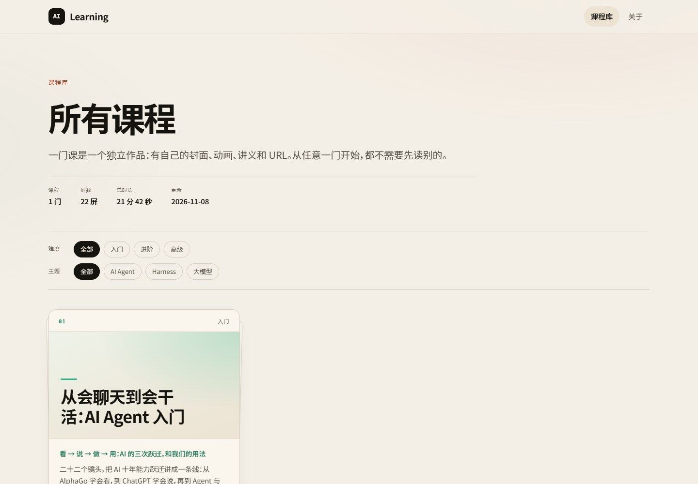

# AI Learning

> 把 AI 讲清楚，一屏一屏地。

AI Learning 是一个用网页动画讲 AI 的教学网站。每一屏只讲一个概念；短课点一下进入下一屏，长视频课程会随旁白自动接续。一门课是一串可以直接在浏览器里播放的动画，而不是一段被锁在播放器里的视频。

当前状态：**v0.8，平台骨架可用，播放页撑满视口，课程水印可配置，课程模板独立交付，外部课程可以直接导入**。站点、课程契约、构建流水线、课程外壳（全视口播放、逐屏进度可拖动、跳到最后）、匿名进度、后台设置页、课程水印配置、独立课程模板包、课程导入和课程 [从会聊天到会干活：AI Agent 入门](courses/ai-first-sees/) 都已经跑通。这门课 22 屏 / 18:38，整门课浅色纸面，旁白驱动动画、字幕在画面底部，播放时像视频一样连续，也可以随时暂停、关字幕、关配音；同一份 composition 可以在服务器上按需导出 MP4，视频不进 Git。CI 与部署还没做。

## 为什么要做

AI 教学常见两种形态：长视频和图文。

长视频有过程感，但信息密度低，不能检索，也很难按自己的节奏停下来。图文可以扫读，却很难把“一步推一步”的过程讲清楚。PPT 式的动画更接近我们想要的东西，但大多数实现最终又导出成视频，绕回同一个问题。

网页可以提供第三种形态：文字是真正的文字，动画是真正的网页元素，讲解可以暂停、回看、搜索，也可以被辅助技术读到。它不必变成 MP4。

## 学习体验

一门课从封面开始：

1. **封面**：这门课讲什么、学完能做什么、大概要多久。
2. **一屏**：一个概念、一个动画、一句结论。动画随旁白自动播放，也可以随时暂停；可以拖动当前屏进度，或点「跳到最后」直接看这一屏的最终画面；长视频课程会像视频一样自动进入下一屏。
3. **下一页**：由学习者控制节奏。可以重播本屏，也可以打开讲义读文字版。
4. **随时退出**：控制条第一个按钮就是「返回课程库」，学到一半不想看了，不用点完所有屏；离开时会停掉并销毁播放器。
5. **结束**：用几条要点回顾这门课，然后回到课程库。


一屏的结构大致是这样：

```text
┌──────────────────────────────────────┐
│ 03 / 08    token 是什么              │  ← 课程外壳：进度、章节
├──────────────────────────────────────┤
│                                      │
│          HyperFrames composition     │  ← 一屏动画（16:9）
│          一个 scene，一个概念         │
│                                      │
├──────────────────────────────────────┤
│ ← 上一屏      ▶ 暂停      下一屏 →    │  ← 播放控制
└──────────────────────────────────────┘
```

课程页可以脱离网站单独打开：`/courses/<slug>/` 是一个完整的静态页面，自带播放器、素材和课程清单。网站只负责封面、目录和引导。

这里的“独立打开”指独立 HTTP 静态部署，不是双击 HTML 文件。播放器需要在同源 iframe 里注入 runtime，`file://` 的浏览器安全策略不支持这种做法；用任意静态服务器打开即可。

## 六条设计原则

**1. 一屏只讲一件事。**
一屏里出现两个中心概念，就拆成两屏。屏幕不是容器，是节拍。

**2. 动画要承担论证。**
动画用来展示关系、过程、因果和变化。能静下来讲清楚的，就不要让它动。动效不是装饰，不能删掉之后论证还完整。

**3. 先直觉，后术语。**
先让学习者看见一个具体的例子，再给它名字。不要用定义解释定义。

**4. 每一屏都能停下来读。**
关键信息不能只存在于运动里。暂停后要看得懂，讲义里要读得到，屏幕阅读器要读得出。

**5. 课程是独立作品。**
每门课有自己的封面、素材、播放器和 URL。它不依赖网站存在，也不因为网站改版而失效。

**6. 网站退后，课程向前。**
网站是封面和索引，不是套在每门课外面的框架。进入课程之后，界面应该安静下来。

## 设计系统

视觉规则不靠口头约定：完整的前端设计契约写在 **[DESIGN.md](DESIGN.md)**，包括色板与令牌、字阶、版式纪律、组件规范、动效理由、文案标点、课程 composition 的 1920×1080 安全区，以及交付前自检清单。

实现上只有一个来源：`design/tokens.css`。它由 `scripts/sync_runtime.py` 同步到站点和课程外壳；页面 CSS 不允许写死新的颜色、圆角或层级。`tests/test_design_contract.py` 会守住其中可机械检查的部分（令牌同步、界面文案零 em-dash、AGENTS.md 必须引用 DESIGN.md）。

当前设计取向：暖纸色 + 墨色 + 单一锈红强调色的亮色系统，不做深色模式；像一叠印刷品，不像 SaaS 面板。

## 为什么不是 MP4
| | MP4 | 网页动画 |
| --- | --- | --- |
| 文字 | 被编码成像素，缩放会糊 | 真实文字，任意分辨率都清晰 |
| 体积 | 几分钟动辄几十到几百 MB | 通常几 MB，按需加载 |
| 检索 | 只能靠字幕文件 | 标题、正文、讲义都可索引 |
| 交互 | 只能播放、暂停、拖进度 | 可以暂停、重播、跳屏、做练习 |
| 更新 | 改一句话要重新编码 | 改 HTML、重新构建，不必重新编码 |
| 无障碍 | 依赖字幕和音轨 | 语义结构、讲义、键盘操作可以一起做 |

代价也要说清楚：网页动画更依赖浏览器性能，自动播放有策略限制，16:9 的画面在手机竖屏上会变小，离线分发也不如一个 MP4 文件简单。这些是真实的工程约束，架构设计会正面处理，而不是假装不存在。

长视频课程是这条原则的延伸，不是例外：旁白、字幕和每屏时长都写在 composition 里，所以同一份源可以用 `npx hyperframes render` 导出 MP4，声音和烧录字幕都在画面里（见 [`courses/ai-first-sees/narration/README.md`](courses/ai-first-sees/narration/README.md)）。网页仍然是主形态；MP4 是同一份 composition 的附属导出，不是另一套需要重新配音、对轨的素材。

## 技术骨架

- **站点**：FastAPI + Jinja2，服务端渲染。负责封面、课程库、课程入口、只读目录 API 和进度 API。没有 SPA，没有前端路由。
- **课程**：独立的静态包。自带课程外壳、播放器运行时、composition、字体和封面。可以部署到任何静态服务器。
- **课程模板与导入**：`course-template/` 是独立的课程模板包，可交给外部作者或 AI；外部生成的课程文件夹通过 `scripts/import_course.py`（或开发环境 `/import` 页面）校验、复制到 `courses/<slug>/`、构建到 `dist/`，并在 SQLite 记一条来源。课程内容仍然是文件，数据库不存课程内容。
- **动画**：HyperFrames composition。一门课一个工程，一屏一个 scene，浏览器里由 `<hyperframes-player>` 播放。
- **构建**：Python 构建脚本。校验课程契约，解析每屏的时间范围，生成课程页面，打包运行时，输出到 `dist/`。
- **数据**：课程内容仍然放在文件里，用 Git 管理；用户、会话和学习进度放在 SQLite，迁移用 Alembic。课程包不依赖数据库也能完整播放，数据库是站点侧的能力。
- **视频**：不是运行时输出，也不进仓库。后台设置页可以在服务器上按需调用 HyperFrames CLI，把同一份 composition 渲染成带旁白和烧录字幕的 MP4，产物留在 `data/videos/`，可删除、可重建。
- **Node**：生产站点页面不依赖 Node；只有后台生成视频时才调用服务器上的 HyperFrames CLI。

站点和课程的关系：

```text
作者                                     学习者
 │                                        │
 ▼                                        ▼
courses/<slug>/  ── build ──▶  dist/courses/<slug>/  ── HTTP ──▶ 浏览器
 course.json                     index.html                       │
 composition/                    course.json                      ├─ 课程封面 / 目录
   index.html                    composition/                     ├─ <hyperframes-player>
   compositions/*.html           runtime/                         │    └─ iframe: composition
   assets/                       cover.webp                       │         └─ runtime 驱动 GSAP
                                                                  └─ 讲义 / 进度 / 控制

FastAPI + Jinja
  /                封面与课程索引
  /courses         课程库
  /courses/<slug>/ 静态课程包（也可以单独部署）
  /api/courses     只读目录 API
  /api/progress    学习进度 API（SQLite）
```

关键边界只有一句话：**站点不需要知道课程内部怎么画，它只读课程契约；课程也不需要知道站点是否存在。** 数据库属于站点，不属于课程包：没有数据库、没有登录态，课程仍然能完整播放。

课程内容用文件，用户状态用 SQLite。这样课程可以随 Git 版本化、独立部署；登录、跨设备进度、收藏这类会变化的数据，才进入数据库。

## 目录结构

```text
ai-learning/
├─ README.md
├─ AGENTS.md                     # 给后续 Agent 的入口
├─ DESIGN.md                     # 前端设计契约（视觉/文案/动效/课程画面）
├─ pyproject.toml                # 依赖、ruff、pytest 配置
├─ alembic.ini                   # 数据库迁移配置
├─ star.cmd                      # Windows 双击启动站点
├─ restart.cmd                   # Windows 双击重启
├─ stop.cmd                      # Windows 双击停止
├─ app/                          # FastAPI 应用
│  ├─ main.py                    # create_app、健康检查、错误模型、静态挂载
│  ├─ config.py                  # 路径、环境变量、站点信息
│  ├─ db.py                      # SQLite / SQLAlchemy engine + pragmas
│  ├─ models.py                  # users / sessions / progress / course_imports
│  ├─ schemas.py                 # 进度 API 的请求/响应
│  ├─ deps.py                    # settings / catalog / db 依赖
│  ├─ auth/sessions.py           # 匿名会话、HttpOnly Cookie
│  ├─ repositories/progress.py   # 进度读写
│  ├─ catalog/                   # 课程契约模型、解析器、资产扫描、目录加载、导入、水印
│  ├─ videos/                    # 后台视频渲染：工具链发现、进程渲染、任务与产物
│  ├─ api/                       # /api/courses、/api/progress、/api/health
│  ├─ web/routes.py              # 首页、课程库、关于、sitemap
│  ├─ web/admin.py               # 后台设置、视频生成/下载、状态轮询、水印配置
│  ├─ web/import_routes.py       # /import 课程导入页（仅开发环境）
│  ├─ templates/                 # Jinja2 模板（含课程卡片、后台页、水印配置页、导入页与登录页）
│  └─ static/                    # 站点 CSS、字体、favicon、后台与导入样式
├─ migrations/                   # Alembic 迁移（0001_initial、0002_course_imports）
├─ data/                         # SQLite 文件与后台生成的视频，不提交
│  └─ videos/                    # 在线生成的 MP4 与元数据
├─ runtime/                      # 课程外壳运行时（所有课程共用）
│  ├─ shell.html.j2              # 课程页面模板
│  ├─ course-deck.js             # 播放器适配层 + 状态机
│  ├─ course-deck.css
│  ├─ vendor/                    # HyperFrames player / runtime（不进 Git）
│  └─ VERSION.json               # 固定版本 + 每个文件的 SHA-256
├─ design/                       # 设计令牌与字体源文件
├─ course-template/              # 独立课程模板包：交给外部作者或 AI 用
│  ├─ AGENTS.md                  # 给 AI 的课程生成指引
│  ├─ COURSE-CONTRACT.md         # 作者版规范
│  ├─ STYLE.md                   # 课程画面视觉规范
│  ├─ course.json                # 合法占位清单
│  ├─ STORYBOARD.md              # 分镜脚手架
│  └─ composition/               # 两屏骨架 + 本地字体 / GSAP
├─ course-inbox/                 # 外部课程收件箱，供导入使用（不进 Git）
├─ courses/
│  ├─ ai-first-sees/             # 第一门课：AI 第一次看懂世界
│  └─ <slug>/                    # 每门课一个目录
│     ├─ course.json
│     ├─ cover.webp              # 可选
│     ├─ STORYBOARD.md           # 课程脚本，不进入构建产物
│     └─ composition/            # HyperFrames 工程
│        ├─ index.html
│        ├─ compositions/
│        └─ assets/              # course.css、fonts/、vendor/gsap.min.js
├─ scripts/
│  ├─ sync_runtime.py            # 拉取 player/runtime/GSAP、子集化字体、同步令牌
│  ├─ build_courses.py           # 校验 + 构建课程包
│  ├─ new_course.py              # 从课程模板生成新课程脚手架
│  ├─ import_course.py           # 导入外部课程文件夹
│  ├─ bootstrap.py               # 双击启动器的环境准备：.venv、依赖、资源、构建、迁移
│  ├─ env.cmd                    # star.cmd / restart.cmd 调用的环境检查（GBK）
│  ├─ serve.py                   # 用正确 MIME 类型静态服务课程包
│  ├─ launcher.py                # star / restart / stop 的实现
│  └─ worktree.py                # 并行开发：git 工作树 + 复用依赖
├─ tests/
│  ├─ fixtures/courses/          # 合法与非法课程夹具
│  └─ e2e/                       # 独立静态服务器上的浏览器验收
├─ tools/package.json            # 固定的 HyperFrames / GSAP 版本（只在创作期用）
├─ .worktree/                    # 任务工作树（git worktree，不进 Git）
├─ docs/
│  ├─ architecture.md
│  ├─ course-contract.md
│  └─ agent-development-plan.md
└─ dist/                         # 构建产物，不提交
   ├─ build.json                 # 构建时间、课程数、内容哈希
   └─ courses/<slug>/
```

## 快速开始

```bash
python -m venv .venv
.venv\Scripts\activate                 # macOS/Linux: source .venv/bin/activate
pip install -e ".[dev]"

cd tools && npm install && cd ..       # 只在创作期需要：固定版本 HyperFrames + GSAP
python scripts/sync_runtime.py         # 把 player/runtime/GSAP/字体布置到 runtime 和课程

python scripts/build_courses.py --all  # 生成 dist/courses/<slug>/
alembic upgrade head                   # 建 SQLite 表
python -m uvicorn app.main:app --reload          # http://127.0.0.1:8000
```

Windows 上不想敲这些命令也没关系：直接双击 `star.cmd`，它会把上面的准备自动做完再启动（见下面「Windows 双击启动」）。

### Windows 双击启动

仓库根目录下的三个脚本面向双击使用（文件以 GBK 保存，匹配中文 Windows 控制台；编辑时请保持 GBK/ANSI 编码，不要另存为 UTF-8）：

| 脚本 | 作用 |
| --- | --- |
| `star.cmd` | 启动站点，默认监听 `0.0.0.0:8081`；第一次双击会自动准备环境 |
| `restart.cmd` | 先停掉正在运行的实例，再按 `star.cmd` 的配置重启 |
| `stop.cmd` | 停止服务 |

**第一次使用只需要双击 `star.cmd`。** 它会先调用 `scripts\env.cmd` 检查环境，缺什么补什么，再交给 `scripts\launcher.py` 启动：

1. 找到本机的 Python 3.11+（找不到时打印下载地址）；
2. 创建 `.venv` 虚拟环境；
3. 安装项目依赖（`pip install -e ".[dev]"`）；
4. 下载固定版本的播放器资源并同步（`npm install` + `python scripts/sync_runtime.py --skip-fonts`）；
5. 构建课程包到 `dist/`；
6. 建好或升级 SQLite 表结构（`alembic upgrade head`）。

这一步要联网，第一次通常几分钟；之后每次双击只做几秒钟的检查，已经就绪的步骤会跳过。开始之前需要 Python 3.11+，第 4 步还需要 Node.js 22+（只在第一次下载播放器资源时用到，之后就绪后启动不再需要 Node）。任何一步失败都会用中文说明原因和下一步怎么做，窗口不会立刻关掉，可以照着提示处理后重新双击。

端口和绑定地址写在 `star.cmd` 开头，改这两行后保存即可：

```text
set "APP_PORT=8081"
set "APP_HOST=0.0.0.0"
```

`0.0.0.0` 表示本机和局域网都能访问；只想本机访问就改成 `127.0.0.1`。启动后直接访问 <http://127.0.0.1:8081>。重启会先读取 `.run/service.json` 里记录的当前实例，再按 `star.cmd` 的配置启动新实例；日志直接输出在脚本窗口里。也可以单独运行 `python scripts\bootstrap.py` 只做环境准备（或加 `--quiet` 检查一遍），准备完再双击 `star.cmd` 启动。

验收命令：

```bash
pytest -q                              # 单元 + 集成 + 浏览器验收
ruff check .                           # 代码检查
python scripts/serve.py dist/courses/ai-first-sees --port 8081   # 独立部署验收
```

> 在 Windows 上用 `python -m http.server` 打开课程包时，`.js` 可能被注册表映射成 `text/plain`，浏览器会拒绝执行 ES module。用 `scripts/serve.py` 验收，它固定了课程包需要的 MIME 类型。

### 并行开发（git 工作树）

本仓库的开发任务都在独立的 git 工作树里进行，主工作树只负责集成（给 AI Agent 的完整规则见 [AGENTS.md](AGENTS.md)「分支与工作树」）：

```powershell
python scripts/worktree.py add feat/course-xyz              # 新建 .worktree\feat-course-xyz
python scripts/worktree.py list                             # 查看工作树、分支与共享状态
python scripts/worktree.py merge feat/course-xyz --remove   # 验证 + 合并回 main + 清理
```

创建工作树时会共享主工作树的 `.venv`、`tools/node_modules`、`tools/ffmpeg`（Windows 目录联接 / POSIX 软链接），并复制 `runtime/vendor` 与 `.env`，所以不需要重新联网安装依赖，新工作树几秒内就能跑测试、构建课程、双击 `star.cmd` 起站点。旁白 TTS 缓存也直接共享，重做旁白不用重新合成已有片段。

共享的代价是依赖目录属于主工作树：**不要在 worktree 里 `pip install` / `npm install`**（启动器检测到共享环境会拒绝重装）；重做旁白也是串行步骤，不要多个工作树同时重建同一门课的旁白。依赖或本地配置变化后，`python scripts/worktree.py link` 会补齐缺失项并刷新 `runtime/vendor`、`.env` 副本。删除工作树请用 `remove`，不要手工删目录；工作树有未提交改动时 `remove` 会拒绝，确认丢弃才加 `--force`。`merge` 默认要求分支有工作树才能跑合并前验证，冲突时会自动回滚主工作树。

## 在线生成课程视频

视频不提交进 Git：项目部署到服务器后，打开 `/admin`（首页右上角有「后台管理」按钮，页脚也有「后台设置」入口），即可看到课程列表、每门课的屏数和视频状态。点「生成视频」，服务器会用构建产物里同一份 composition 渲染 MP4；完成后点「下载视频」。页面不需要额外的前端构建。

生成发生在服务器上，工作方式如下：

1. 后台把 `dist/courses/<slug>/composition/` 复制到临时工作目录，不污染 `dist/`。
2. 调用固定版本的 HyperFrames CLI 渲染，质量档默认 `looks`。
3. 视频和元数据写到 `data/videos/`（`<slug>.mp4` 和 `<slug>.json`），失败时保留 `<slug>.render.log`。
4. 同一时间只跑一个任务；服务重启后不会续跑，遗留任务标记为中断。

### 服务器前提

站点页面本身仍然只依赖 Python。只有在线生成视频需要下面这些，装在跑站点的机器上：

| 依赖 | 用途 | 安装方式 |
| --- | --- | --- |
| Node.js 22+ | 运行 HyperFrames CLI | 发行版包管理器或 [nodejs.org](https://nodejs.org) |
| HyperFrames 0.9.19 | 浏览器帧捕捉与 MP4 编码 | 在 `tools/` 里 `npm install`（后台会自动发现），或 `npx --yes hyperframes@0.9.19`（首次需要网络），或用 `VIDEO_HYPERFRAMES_CLI` 指向 `hyperframes.mjs` |
| Chromium | 渲染 composition | `npx hyperframes browser ensure` |
| FFmpeg / FFprobe | 编码与探测 | 加入 `PATH`，或设置 `VIDEO_FFMPEG_DIR`；仓库本地的 `tools/ffmpeg/bin` 会被自动发现 |

后台页面顶部的「生成环境」会逐项列出 Node.js、HyperFrames、FFmpeg、FFprobe 是否找到；缺什么就按提示补什么。

### 配置

| 变量 | 默认 | 说明 |
| --- | --- | --- |
| `ADMIN_TOKEN` | 空 | 后台管理密码。**部署到公网前必须设置**；留空时后台不设防 |
| `VIDEO_OUTPUT_DIR` | `data/videos` | 视频与元数据目录，不进 Git |
| `VIDEO_WORK_DIR` | `data/videos/.work` | 渲染临时目录 |
| `VIDEO_QUALITY` | `looks` | `draft` / `looks` / `delivery` |
| `VIDEO_RENDER_TIMEOUT_SECONDS` | `7200` | 单次渲染超时 |
| `VIDEO_HYPERFRAMES_CLI` | 空 | 自定义 HyperFrames CLI 路径 |
| `VIDEO_HYPERFRAMES_VERSION` | `0.9.19` | npx 兜底时使用的版本 |
| `VIDEO_NODE_BIN` / `VIDEO_NPX_BIN` | `node` / `npx` | Node 与 npx 路径 |
| `VIDEO_FFMPEG_DIR` | 空 | 存放 `ffmpeg` / `ffprobe` 的目录 |

### 安全与容量

- 后台默认没有密码，只适合本机或内网。公网部署请设置 `ADMIN_TOKEN`，并最好再套一层反向代理的访问控制。
- 渲染是重活：一次 20 分钟课程在本机可能跑几十分钟，并占用 Chrome 和 FFmpeg 的 CPU。同一时间只跑一个任务。
- `data/videos/` 会随视频数量增长。视频可随时删除，删掉后重新生成即可；它不参与构建，也不影响网页播放。

## 配置课程水印

每门课可以单独配置两种水印，打开 `/admin`（首页右上角「后台管理」，或页脚「后台设置」），在课程行点「水印配置」：

- **角标水印**：四个角各最多一条，放作者、公司、版权信息。可调文字、字号、颜色、透明度；文字留空表示这个角不显示。
- **满屏平铺水印**：同一句话从上到下、从左到右重复铺满播放画面，用来降低截图外传的可读性。可调文字、字号、颜色、透明度、横纵步长和倾斜角。

页面带 16:9 预览，保存后会写进 `courses/<slug>/course.json` 的 `watermark` 字段，并自动重新构建这门课的课程包。水印只覆盖 16:9 播放画布，不挡控制条、不拦截点击，进入全屏仍然保留；独立部署的课程包也自带水印，不依赖站点、数据库或 API。

前提与边界：

- 配置页需要 `courses/<slug>/course.json` 源文件和构建工具。只部署 `app/` 与 `dist/` 的机器上页面为只读，请在持有课程源的机器上配置。
- 后台写接口和其他 `/admin` 操作一样受 `ADMIN_TOKEN`、同源检查和 `no-store` 保护。
- 水印是署名和截图威慑，**不是访问控制**：它不能阻止截图、下载或查看页面源码。需要权限控制时用登录和访问策略。
- 手工改 `watermark` 字段后，要运行 `python scripts/build_courses.py --course <slug>` 才会生效；后台配置页会自动构建。

## 添加一门课程

目标：只动 `courses/<slug>/`，不改站点代码。

1. 先生成脚手架：`python scripts/new_course.py <slug> --title "课程标题"`（从 `course-template/` 复制 `course.json`、`STORYBOARD.md`、`composition/`）。外部作者也可以拿 `course-template/` 按它的 `AGENTS.md` 生成，再用下一节的导入流程带进来。
2. 写 `STORYBOARD.md`：每屏一句话，说明这一屏让学习者看见什么、动画如何论证。
3. 改 `course.json`：标题、承诺、目标、每一屏的文案；交付前把 `status` 改成 `published`。
4. 在 `composition/` 里用 HyperFrames 做每一屏的 scene，并在根 composition 里挂好时间。
5. 运行 `python scripts/build_courses.py --course <slug>`，打开两个地址验收：站点里的 `/courses/<slug>/`，以及 `python scripts/serve.py` 打开的同一个目录。

构建完成后，课程清单、封面、目录和 API 会自动更新。具体字段和校验规则见[课程契约](docs/course-contract.md)。

## 课程模板与导入

`course-template/` 是独立的课程模板包：两屏可构建骨架 + 给作者和 AI 的文档。它不放在 `courses/` 下参与构建，可以整个文件夹交给外部作者或其他 AI，放进 AI 的工作目录后由其中的 `AGENTS.md` 指引生成课程。

```text
course-template/
├─ AGENTS.md            # 给 AI 的操作指引：输入、流程、硬规则、自检、交付
├─ COURSE-CONTRACT.md   # 作者版规范：目录、字段、时间、资源、错误码
├─ STYLE.md             # 课程画面视觉规范（纸色、字阶、安全区、动效）
├─ course.json          # 合法占位清单（slug 仍是 your-course-slug）
├─ STORYBOARD.md        # 分镜脚手架
└─ composition/         # 根 composition + 两屏 scene + 本地字体 / GSAP
```

外部作者产出的课程文件夹有两种方式进入站点：

1. **导入（推荐）**：把整个课程文件夹放进仓库根的 `course-inbox/`（该目录不进 Git），然后：

   ```bash
   python scripts/import_course.py --inbox            # 批量导入收件箱
   python scripts/import_course.py <课程文件夹>       # 只导入一个
   python scripts/import_course.py --dry-run <文件夹>  # 只校验，不落盘
   ```

   开发环境也可以打开 `/import` 页面：列出收件箱里的课程、校验状态和「导入」按钮，并显示最近导入记录；生产环境（`ENV=prod`）不开放这个页面。导入会先校验、再在隐藏临时目录里构建，全部通过才原子替换 `courses/<slug>/` 和 `dist/courses/<slug>/`，失败会回滚。成功后站点下一次请求就能看到新课，不用重启。

2. **直接放进课程目录**：复制成 `courses/<slug>/`（目录名必须等于 `course.json` 的 `slug`），运行 `python scripts/build_courses.py --course <slug>`；也可以用 `python scripts/import_course.py courses/<slug>` 校验并原地重建。

导入成功后会在 SQLite 的 `course_imports` 表更新一条来源记录（slug、标题、来源路径、内容哈希、屏数、时长、导入时间）。课程内容仍然在文件里，数据库只记来源；表没迁移或数据库不可用时导入照常完成，只打印警告。

模板自带的字体是预生成的字符子集；导入的课程如果用了子集外的新字，跑一次 `python scripts/sync_runtime.py` 会按课程文案重新生成子集。

导入相关配置（完整说明见 `.env.example`）：

| 变量 | 默认 | 说明 |
| --- | --- | --- |
| `COURSES_INBOX_DIR` | `course-inbox` | 导入收件箱目录 |
| `COURSE_IMPORT_ENABLED` | `dev` 为 1，`prod` 为 0 | 是否开放 `/import` 页面 |

模板包的完整用法见 [course-template/README.md](course-template/README.md)；导入的字段和错误码规则见[课程契约](docs/course-contract.md) 7.7。

## 站点




## 项目状态

- **v0.1**：README、架构设计、课程契约、Agent 开发方案。
- **v0.2**：FastAPI 站点、课程契约与解析器、构建流水线、SQLite + Alembic 匿名进度、课程外壳（封面/切屏/控制条/讲义/完成页/错误页）、第一门课「AI 第一次看懂世界」、Playwright 独立部署验收。
- **v0.3**：CI（契约/外部资源/独立部署）、Docker 与部署、课程脚手架脚本、更多系列课程。
- **v0.4**：长视频课程按新版导演脚本重做，22 屏 / 21:42，旁白驱动、连续播放。
- **v0.5**：后台设置页 `/admin`，可在服务器上按需生成并下载课程视频；视频不进 Git，网页仍是主形态。
- **v0.6**：课程模板抽成独立包 `course-template/`，外部作者可以拿它交给 AI 生成课程；`scripts/new_course.py` 脚手架、`scripts/import_course.py` 和开发环境 `/import` 页面支持把外部课程校验、构建并登记来源后直接加入课程库。
- **v0.7（当前）**：播放页撑满视口，16:9 画布按可用区域等比最大化、控制条通栏；当前屏进度可拖动，新增「跳到最后」（`End`），课程总进度按全课时间连续增长。
- **v1.0**：课程库规模化、质量门、账号与跨设备进度。

没有日期承诺。先把结构做对，再往上加课程。

## 文档

- [前端设计契约](DESIGN.md)：视觉、文案、动效与课程 composition 的唯一准则。
- [架构设计](docs/architecture.md)：系统边界、关键决策、运行时、构建、部署和风险。
- [课程契约](docs/course-contract.md)：一门课需要长什么样，字段、目录、时间规则和验收清单。
- [课程模板包](course-template/README.md)：可以整个交付给外部作者的课程骨架、AI 操作指引和作者规范。
- [Agent 开发方案](docs/agent-development-plan.md)：按阶段执行的任务、验收标准和每门新课的生产模板。

## 致谢

- [HyperFrames](https://hyperframes.heygen.com)：HTML 动画与浏览器内播放器，Apache-2.0。
- [GSAP](https://gsap.com)：动画时间轴。
- [Noto Sans SC](https://fonts.google.com/noto/specimen/Noto+Sans+SC)：中文正文字体，SIL Open Font License。
- [FastAPI](https://fastapi.tiangolo.com) 与 [Jinja2](https://jinja.palletsprojects.com)：站点后端与模板。

第三方组件的许可证文件会随运行时一起分发。正式发布前需要再核对一次 GSAP 的授权范围。
