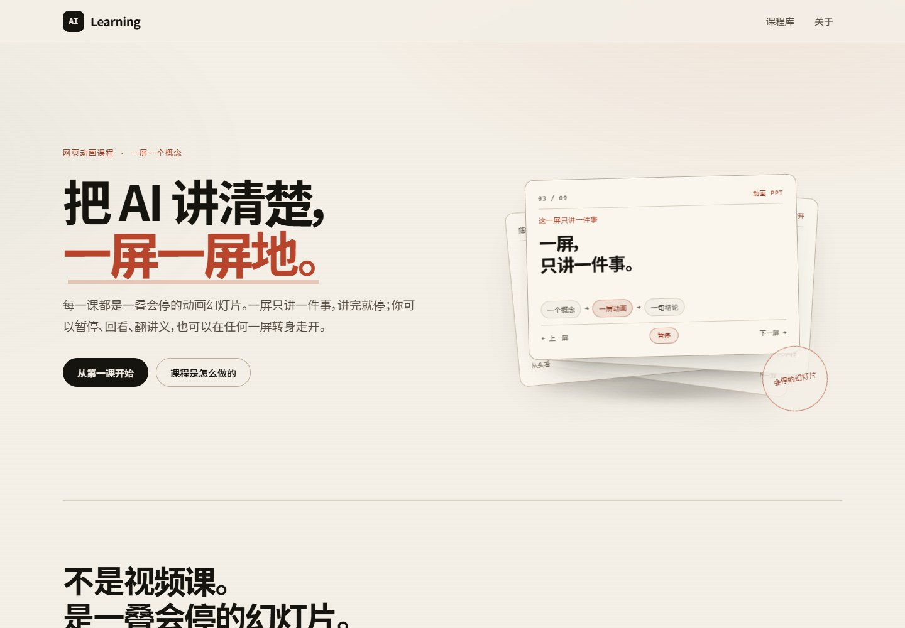
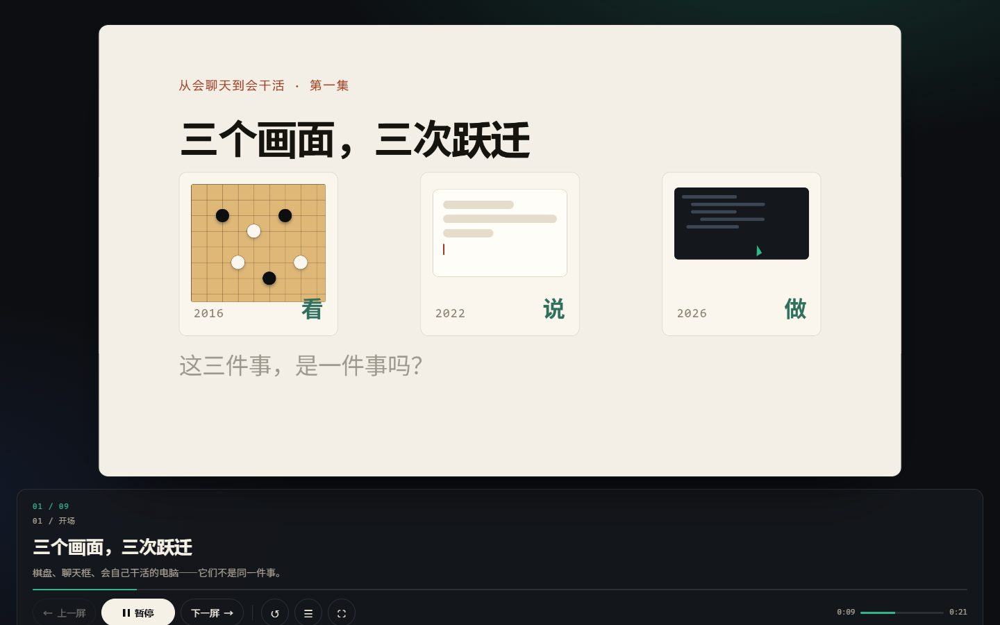

# 页间课堂

> 一页一页讲，随时可以停。

页间课堂是一个交互式视频课平台：课程像视频一样连续播放，翻开来是一页一页的动态幻灯片，每一页都能停。当前第一个系列是 AI Learning，讲 AI；每屏只讲一个概念，短课点一下进入下一屏，长视频课程会随旁白自动接续。一门课是一串可以直接在浏览器里播放的动画。

当前版本 **v0.14**：站点可以导出成静态目录并发布到 GitHub Pages。完整版本记录见[版本记录](docs/release-notes.md)。



## 为什么值得做

AI 教学常见两种形态：长视频和图文。长视频有过程感，但信息密度低，不能检索，也很难按自己的节奏停下来；图文可以扫读，却很难把“一步推一步”的过程讲清楚。网页可以提供第三种形态：文字是真正的文字，动画是真正的网页元素，讲解可以暂停、回看、搜索，也可以被辅助技术读到。

代价也要说清楚：网页动画更依赖浏览器性能，自动播放有策略限制，16:9 的画面在手机竖屏上会变小，离线分发也不如一个 MP4 文件简单。这些是真实的工程约束，架构设计会正面处理，而不是假装不存在。

完整的产品说明（学习体验、六条设计原则、为什么不是 MP4）见[产品说明](docs/product.md)。

## 它是什么样的

一门课从封面开始：

1. **封面**：这门课讲什么、学完能做什么、大概要多久。
2. **一屏**：一个概念、一个动画、一句结论。动画随旁白自动播放，也可以随时暂停；可以拖动当前屏进度，或点「跳到最后」直接看这一屏的最终画面。
3. **下一页**：由学习者控制节奏。可以重播本屏，也可以打开目录直接跳到任意一屏，或打开讲义读文字版。
4. **随时退出**：课程页顶部有一条吸顶的「返回课程库」；进入播放后改用控制条第一个按钮「退出课程（返回课程库）」。
5. **结束**：用几条要点回顾这门课，然后回到课程库。



课程页可以脱离网站单独打开：`/courses/<slug>/` 是一个完整的静态页面，自带播放器、素材和课程清单。网站只负责封面、目录和引导。

## 设计原则

课程形态遵循六条原则：一屏只讲一件事；动画要承担论证；先直觉，后术语；每一屏都能停下来读；课程是独立作品；网站退后，课程向前。展开见[产品说明](docs/product.md#六条设计原则)。

视觉规则不靠口头约定：完整的前端设计契约写在 **[DESIGN.md](DESIGN.md)**，实现上只有一个来源 `design/tokens.css`。它由 `scripts/sync_runtime.py` 同步到站点和课程外壳；页面 CSS 不允许写死新的颜色、圆角或层级。`tests/test_design_contract.py` 会守住其中可机械检查的部分。

## 技术骨架

- **站点**：FastAPI + Jinja2，服务端渲染。负责封面、课程库、课程入口、只读目录 API 和进度 API。没有 SPA，没有前端路由。
- **课程**：独立的静态包，自带课程外壳、播放器运行时、composition、字体和封面，可以部署到任何静态服务器。
- **课程模板与导入**：`course-template/` 是独立的课程模板包，可交给外部作者或 AI；外部生成的课程通过 `scripts/import_course.py`（或开发环境 `/import` 页面）校验、复制到 `courses/<slug>/`、构建，课程内容仍然是文件。
- **动画**：HyperFrames composition。一门课一个工程，一屏一个 scene，浏览器里由 `<hyperframes-player>` 播放。
- **构建**：Python 构建脚本。校验课程契约，解析每屏的时间范围，生成课程页面，打包运行时，输出到 `dist/`。
- **数据**：课程内容放在文件里，用 Git 管理；用户、会话和学习进度放在 SQLite。课程包不依赖数据库也能完整播放。
- **视频**：不是运行时输出，也不进仓库。后台设置页可以按需把同一份 composition 渲染成 MP4，产物留在 `data/videos/`；生产站点页面本身不依赖 Node。

关键边界只有一句话：**站点不需要知道课程内部怎么画，它只读课程契约；课程也不需要知道站点是否存在。** 系统边界、关键决策和完整目录树见[架构设计](docs/architecture.md)和[开发指南](docs/development.md#仓库结构)。

## 快速开始

```bash
python -m venv .venv
.venv\Scripts\activate                 # macOS/Linux: source .venv/bin/activate
pip install -e ".[dev]"
cd tools && npm install && cd ..       # 固定版本的 HyperFrames + GSAP，sync_runtime 从这里取播放器
python scripts/sync_runtime.py
python scripts/build_courses.py --all
alembic upgrade head
python -m uvicorn app.main:app --reload          # http://127.0.0.1:8000
```

Windows 上直接双击 `start.cmd`（首次自动准备环境）；改完项目后双击 `build.cmd` 重建，再双击 `start.cmd` 或 `restart.cmd` 看最新版本。环境要求、分步说明、端口配置和常见故障见[快速开始](docs/getting-started.md)。

## 文档

完整索引见[文档导航](docs/README.md)。常用入口：

- **上手**：[快速开始](docs/getting-started.md)、[开发指南](docs/development.md)
- **写课程**：[添加与导入课程](docs/course-authoring.md)、[课程契约](docs/course-contract.md)、[课程模板包](course-template/README.md)
- **运行与发布**：[后台与运维](docs/admin.md)、[部署与发布](docs/deployment.md)、[架构设计](docs/architecture.md)
- **产品与设计**：[产品说明](docs/product.md)、[前端设计契约](DESIGN.md)、[Agent 开发方案](docs/agent-development-plan.md)
- **记录**：[版本记录](docs/release-notes.md)、[完整文档导航](docs/README.md)

## 项目状态

v0.14，平台骨架可用，站点可以静态发布。第一门课 [从会聊天到会干活：AI Agent 入门](courses/ai-first-sees/) 共 28 屏 / 29:54。还没有 Docker 打包和正式的生产部署流程；登录、搜索也没有做。下一步是 v1.0：课程库规模化、质量门、账号与跨设备进度。

## 致谢

- [HyperFrames](https://hyperframes.heygen.com)：HTML 动画与浏览器内播放器，Apache-2.0。
- [GSAP](https://gsap.com)：动画时间轴。
- [Noto Sans SC](https://fonts.google.com/noto/specimen/Noto+Sans+SC)：中文正文字体，SIL Open Font License。
- [FastAPI](https://fastapi.tiangolo.com) 与 [Jinja2](https://jinja.palletsprojects.com)：站点后端与模板。

第三方组件的许可证文件会随运行时一起分发。正式发布前需要再核对一次 GSAP 的授权范围。
