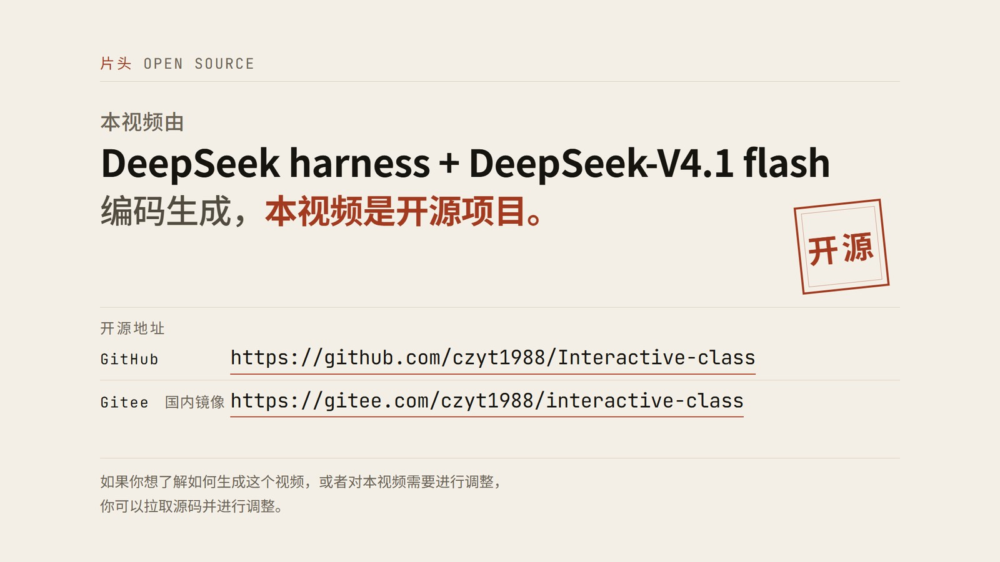
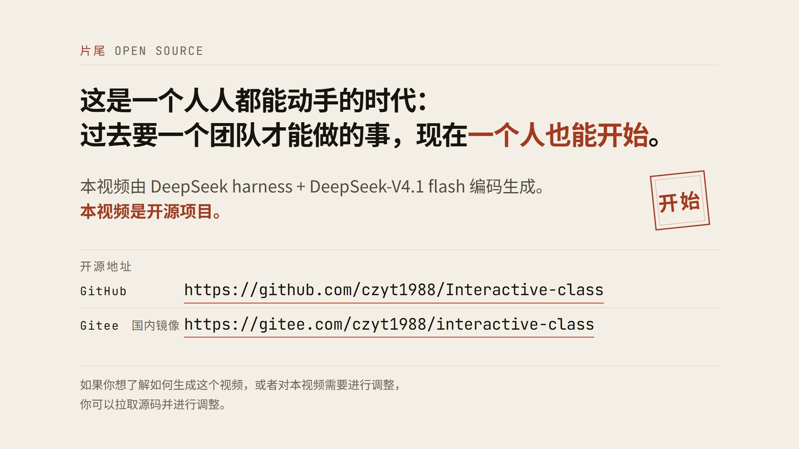

# 后台与运维

后台是站点的可选能力：按需生成课程视频、配置课程水印、选择片头片尾。它不影响网页播放的主链路，课程包在没有后台和数据库时仍然完整可用。

打开 `/admin`（首页右上角有「后台管理」按钮，页脚也有「后台设置」入口），可以看到课程列表、每门课的屏数和视频状态，以及每门课的「水印配置」「片头片尾」入口。后台页面不需要额外的前端构建。

## 在线生成课程视频

视频不提交进 Git：部署到服务器后，在 `/admin` 点「生成视频」，服务器会用构建产物里同一份 composition 渲染 MP4；完成后再点「下载视频」。课程配置了水印时，水印在构建时已写进 composition，导出的 MP4 里也有，和网页播放画面一致；配了片头/片尾时，它们也是 composition 的一屏，导出的视频同样带。

生成发生在服务器上，工作方式如下：

1. 后台把 `dist/courses/<slug>/composition/` 复制到临时工作目录，不污染 `dist/`。
2. 调用固定版本的 HyperFrames CLI 渲染，质量档默认 `looks`。
3. 视频和元数据写到 `data/videos/`（`<slug>.mp4` 和 `<slug>.json`），失败时保留 `<slug>.render.log`。
4. 同一时间只跑一个任务；服务重启后不会续跑，遗留任务标记为中断。

### 服务器前提

站点页面本身仍然只依赖 Python。只有在线生成视频需要下面这些，装在跑站点的机器上：

| 依赖 | 用途 | 安装方式 |
| --- | --- | --- |
| Node.js 22+ | 运行 HyperFrames CLI | 发行版包管理器或 [nodejs.org](https://nodejs.org) |
| HyperFrames 0.9.19 | 浏览器帧捕捉与 MP4 编码 | 在 `tools/` 里 `npm install`（后台会自动发现），或 `npx --yes hyperframes@0.9.19`（首次需要网络），或用 `VIDEO_HYPERFRAMES_CLI` 指向 `hyperframes.mjs` |
| Chromium | 渲染 composition | `npx hyperframes browser ensure` |
| FFmpeg / FFprobe | 编码与探测 | 加入 `PATH`，或设置 `VIDEO_FFMPEG_DIR`；仓库本地的 `tools/ffmpeg/bin` 会被自动发现 |

后台页面顶部的「生成环境」会逐项列出 Node.js、HyperFrames、FFmpeg、FFprobe 是否找到；缺什么就按提示补什么。

### 配置

| 变量 | 默认 | 说明 |
| --- | --- | --- |
| `ADMIN_TOKEN` | 空 | 后台管理密码。**部署到公网前必须设置**；留空时后台不设防 |
| `VIDEO_OUTPUT_DIR` | `data/videos` | 视频与元数据目录，不进 Git |
| `VIDEO_WORK_DIR` | `data/videos/.work` | 渲染临时目录 |
| `VIDEO_QUALITY` | `looks` | `draft` / `looks` / `delivery` |
| `VIDEO_RENDER_TIMEOUT_SECONDS` | `7200` | 单次渲染超时 |
| `VIDEO_HYPERFRAMES_CLI` | 空 | 自定义 HyperFrames CLI 路径 |
| `VIDEO_HYPERFRAMES_VERSION` | `0.9.19` | npx 兜底时使用的版本 |
| `VIDEO_NODE_BIN` / `VIDEO_NPX_BIN` | `node` / `npx` | Node 与 npx 路径 |
| `VIDEO_FFMPEG_DIR` | 空 | 存放 `ffmpeg` / `ffprobe` 的目录 |

### 安全与容量

- 后台默认没有密码，只适合本机或内网。公网部署请设置 `ADMIN_TOKEN`，并最好再套一层反向代理的访问控制。
- 渲染是重活：一次 20 分钟课程在本机可能跑几十分钟，并占用 Chrome 和 FFmpeg 的 CPU。同一时间只跑一个任务。
- `data/videos/` 会随视频数量增长。视频可随时删除，删掉后重新生成即可；它不参与构建，也不影响网页播放。
- 渲染是单进程任务，服务重启后不会续跑；遗留任务会被标记为中断，重新点一次生成即可。

方案背景和任务模型见[架构设计](architecture.md) 7.11。

## 配置课程水印

每门课可以单独配置两种水印，打开 `/admin`，在课程行点「水印配置」：

- **角标水印**：四个角各最多一条，放作者、公司、版权信息。可调文字、字号、颜色、透明度；文字留空表示这个角不显示。
- **满屏平铺水印**：同一句话从上到下、从左到右重复铺满播放画面，用来降低截图外传的可读性。可调文字、字号、颜色、透明度、横纵步长和倾斜角。

页面带 16:9 预览，保存后会写入站点数据库的 `course_watermarks` 表，并自动重新构建这门课的课程包。水印文字**不进 Git、不写课程源文件**：它只存在于数据库（`data/app.db`，已被 gitignore）和构建产物 `dist/` 里。构建把水印层写进课程 composition（网页播放器和 MP4 渲染器消费的同一份画面），所以网页播放和后台导出的视频带同一层水印；水印只覆盖 16:9 播放画布，不挡控制条、不拦截点击，进入全屏仍然保留；独立部署的课程包也自带水印，不依赖站点、数据库或 API。

前提与边界：

- 新克隆的仓库、刚导入的课程默认没有水印，需要在这台部署的机器上配置一次并重建；`course.json` 里写 `watermark` 字段会被当作未知字段报错。
- 保存水印需要 `courses/<slug>/course.json` 源文件和构建工具。只部署 `app/` 与 `dist/` 的机器上页面为只读，请在持有课程源的机器上配置。
- 构建（包括 `python scripts/build_courses.py`）会从数据库读水印；库或表不存在时按「未配置水印」继续，所以不迁移数据库也能构建，只是没有水印。`--no-watermarks` 可做完全不读库的干净构建。
- 后台写接口和其他 `/admin` 操作一样受 `ADMIN_TOKEN`、同源检查和 `no-store` 保护。
- 水印是署名和截图威慑，**不是访问控制**：它不能阻止截图、下载或查看页面源码。需要权限控制时用登录和访问策略。
- 站点给课程包发 `Cache-Control: no-cache`：保存并重建后，普通刷新或从课程库重新进入就会拿到新版本，只有固定版本的 player 文件是长缓存。
- 改水印会让内容哈希变化，已生成的旧视频会被标记为过期，需要重新生成。

设计与存储理由见[架构设计](architecture.md) 7.12 和课程契约 3.7、7.8。

## 配置片头片尾

每门课可以在最前面插一个片头、在最后插一个片尾。片头/片尾不是课程字段，而是**全站共享的模板**：构建时渲染成课程 composition 里的一屏，网页播放和导出的 MP4 都会带上。打开 `/admin`，在课程行点「片头片尾」，各选一个模板（或选「不插入」），保存后会写入站点数据库的 `course_clips` 表并自动重新构建这门课。

仓库自带两个模板，默认都不插入：

- `clips/intro-title-page/`：通用开源片头，7 秒；说明本视频由 DeepSeek harness + DeepSeek-V4.1 flash 生成，固定列出本仓库的 GitHub 与 Gitee 地址，不印课程标题、屏数或时长。
- `clips/outro-colophon/`：通用开源片尾，9 秒；重复制作方式和两个地址，并用一句「这是一个人人都能动手的时代」收束。

每个模板旁边有「预览」按钮：点开会临时构建一份只含该模板的课程包，在真实课堂页面里从这一屏开始播放。预览页顶部有「片头预览/片尾预览」条和「返回设置」，播到这一屏结束就停，不会进入正课或完成页，也不会写学习进度、不会改数据库里的选择。临时包放在 `data/clip-previews/`，可以随时删掉，下一次预览会重建。

模板目录结构、`clip.json` 字段、`{{course.title}}` 等占位符见 [clips/README.md](../clips/README.md)。自带的通用片头、片尾都不使用课程占位符，所以同一条片头/片尾可以贴到任何视频前。片头/片尾的画面就是课程的一屏：1920×1080、亮色纸面，静默无旁白，目录里标成「片头」「片尾」，正课编号不变。

前提与边界：

- 片头和片尾的两个地址都写在各自的 `scene.html` 里，不随课程或 `.env` 变化；换 fork 时改模板并重新保存一次。`PROJECT_URL` 仍供使用 `{{project.url}}` 的自定义模板。
- 选择存数据库（`data/app.db`，已 gitignore），不写 `course.json`；构建产物自带渲染后的 scene，独立部署的课程包不依赖数据库。
- 没有选择时构建输出与旧版一致。`--no-clips` 可做完全不读库的干净构建。
- 保存需要在持有 `courses/<slug>/` 源文件的机器上做；只部署 `app/` 与 `dist/` 时页面只读。
- 片头/片尾是静默的一屏（不配旁白/音乐）；插入后正课时间整体后移，内容哈希会变，已生成的旧视频会被标记为过期。

设计与注入流程见[架构设计](architecture.md) 7.13 和课程契约 3.8、7.9。

## 后台的安全边界

- 公网部署必须设置 `ADMIN_TOKEN`；后台登录用 Cookie，写接口还检查同源 `Origin`。
- 只部署 `app/` 与 `dist/` 的机器没有课程源文件：视频可以生成和下载，但水印、片头片尾和导入页面会变成只读或不可用，这是预期行为。
- 后台不提供单独的用户管理；用户、会话和匿名进度都在 SQLite 里，备份和恢复见[部署与发布](deployment.md#备份与回滚)。
