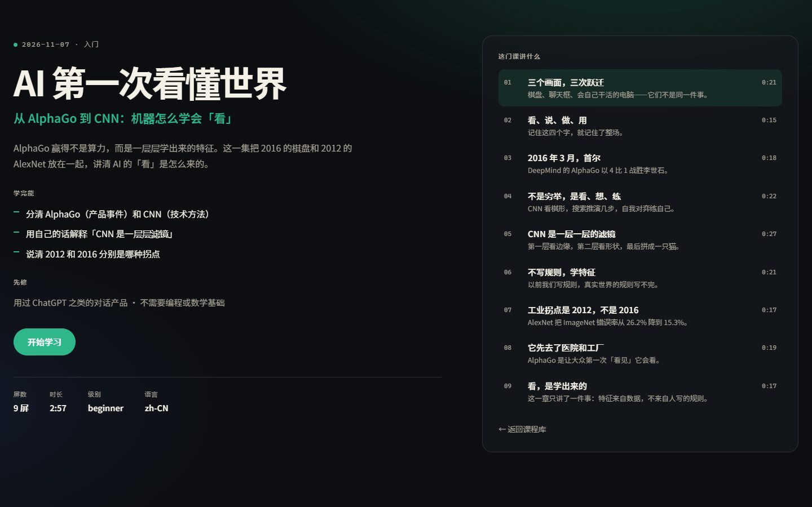
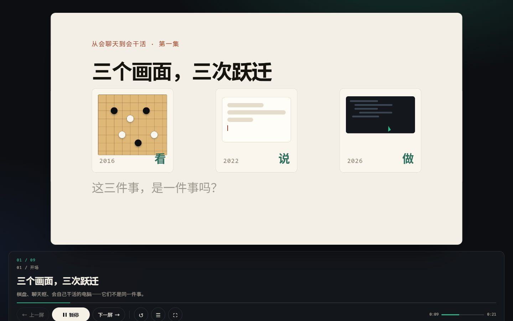
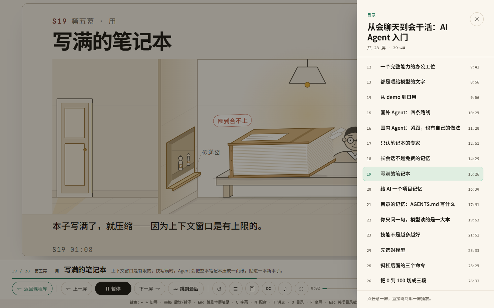
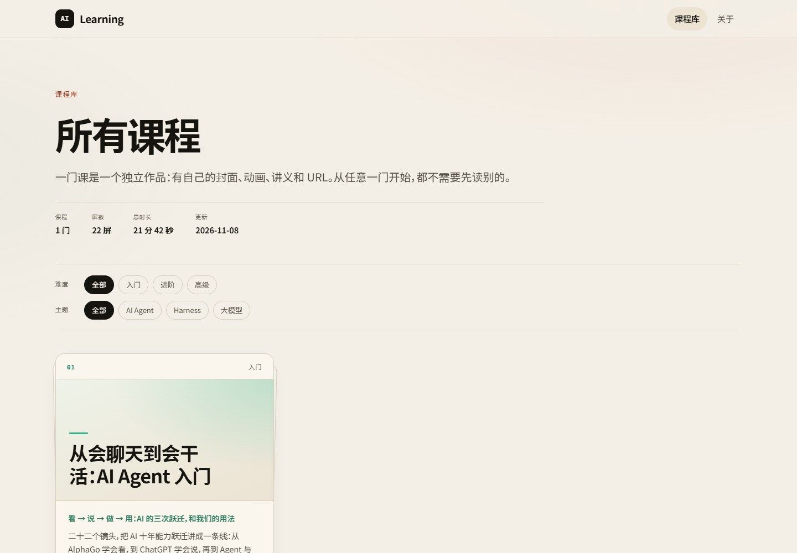

# 产品说明：页间课堂

> 一页一页讲，随时可以停。

页间课堂是一个交互式视频课平台：课程像视频一样连续播放，翻开来是一页一页的动态幻灯片，每一页都能停。当前第一个系列是 AI Learning，讲 AI；每屏只讲一个概念，短课点一下进入下一屏，长视频课程会随旁白自动接续。一门课是一串可以直接在浏览器里播放的动画。

这份文档说明产品为什么长这样：要解决的问题、学习体验、六条设计原则，以及为什么主形态是网页而不是 MP4。安装和开发步骤见[快速开始](getting-started.md)，系统边界和实现见[架构设计](architecture.md)。

## 为什么要做

AI 教学常见两种形态：长视频和图文。

长视频有过程感，但信息密度低，不能检索，也很难按自己的节奏停下来。图文可以扫读，却很难把“一步推一步”的过程讲清楚。PPT 式的动画更接近我们想要的东西，但大多数实现最终又导出成视频，绕回同一个问题。

网页可以提供第三种形态：文字是真正的文字，动画是真正的网页元素，讲解可以暂停、回看、搜索，也可以被辅助技术读到。它不必变成 MP4。

## 学习体验

一门课从封面开始：

1. **封面**：这门课讲什么、学完能做什么、大概要多久。
2. **一屏**：一个概念、一个动画、一句结论。动画随旁白自动播放，也可以随时暂停；可以拖动当前屏进度，或点「跳到最后」直接看这一屏的最终画面；长视频课程会像视频一样自动进入下一屏。
3. **下一页**：由学习者控制节奏。可以重播本屏，也可以打开目录直接跳到任意一屏，或打开讲义读文字版。
4. **随时退出**：课程页顶部有一条吸顶的「返回课程库」，封面阶段不用滚动就能离开；进入播放后改用控制条第一个按钮「退出课程（返回课程库）」，完成页和错误页也各有自己的返回按钮。学到一半不想看了，不用点完所有屏；离开时会停掉并销毁播放器。
5. **结束**：用几条要点回顾这门课，然后回到课程库。







一屏的结构大致是这样：

```text
┌──────────────────────────────────────┐
│ 03 / 08    token 是什么              │  ← 课程外壳：进度、章节
├──────────────────────────────────────┤
│                                      │
│          HyperFrames composition     │  ← 一屏动画（16:9）
│          一个 scene，一个概念         │
│                                      │
├──────────────────────────────────────┤
│ ← 上一屏      ▶ 暂停      下一屏 →    │  ← 播放控制
└──────────────────────────────────────┘
```

课程页可以脱离网站单独打开：`/courses/<slug>/` 是一个完整的静态页面，自带播放器、素材和课程清单。网站只负责封面、目录和引导。

这里的“独立打开”指独立 HTTP 静态部署，不是双击 HTML 文件。播放器需要在同源 iframe 里注入 runtime，`file://` 的浏览器安全策略不支持这种做法；用任意静态服务器打开即可。

## 六条设计原则

**1. 一屏只讲一件事。**
一屏里出现两个中心概念，就拆成两屏。屏幕不是容器，是节拍。

**2. 动画要承担论证。**
动画用来展示关系、过程、因果和变化。能静下来讲清楚的，就不要让它动。动效不是装饰，不能删掉之后论证还完整。

**3. 先直觉，后术语。**
先让学习者看见一个具体的例子，再给它名字。不要用定义解释定义。

**4. 每一屏都能停下来读。**
关键信息不能只存在于运动里。暂停后要看得懂，讲义里要读得到，屏幕阅读器要读得出。

**5. 课程是独立作品。**
每门课有自己的封面、素材、播放器和 URL。它不依赖网站存在，也不因为网站改版而失效。

**6. 网站退后，课程向前。**
网站是封面和索引，不是套在每门课外面的框架。进入课程之后，界面应该安静下来。

## 为什么不是 MP4

| | MP4 | 网页动画 |
| --- | --- | --- |
| 文字 | 被编码成像素，缩放会糊 | 真实文字，任意分辨率都清晰 |
| 体积 | 几分钟动辄几十到几百 MB | 通常几 MB，按需加载 |
| 检索 | 只能靠字幕文件 | 标题、正文、讲义都可索引 |
| 交互 | 只能播放、暂停、拖进度 | 可以暂停、重播、跳屏、做练习 |
| 更新 | 改一句话要重新编码 | 改 HTML、重新构建，不必重新编码 |
| 无障碍 | 依赖字幕和音轨 | 语义结构、讲义、键盘操作可以一起做 |

代价也要说清楚：网页动画更依赖浏览器性能，自动播放有策略限制，16:9 的画面在手机竖屏上会变小，离线分发也不如一个 MP4 文件简单。这些是真实的工程约束，架构设计会正面处理，而不是假装不存在。

长视频课程是这条原则的延伸，不是例外：旁白、字幕和每屏时长都写在 composition 里，所以同一份源可以用 `npx hyperframes render` 导出 MP4，声音和烧录字幕都在画面里（见 [`courses/ai-first-sees/narration/README.md`](../courses/ai-first-sees/narration/README.md)）。网页仍然是主形态；MP4 是同一份 composition 的附属导出，不是另一套需要重新配音、对轨的素材。

## 课程与站点

站点和课程的关系：

```text
作者                                     学习者
 │                                        │
 ▼                                        ▼
courses/<slug>/  ── build ──▶  dist/courses/<slug>/  ── HTTP ──▶ 浏览器
 course.json                     index.html                       │
 composition/                    course.json                      ├─ 课程封面 / 目录
   index.html                    composition/                     ├─ <hyperframes-player>
   compositions/*.html           runtime/                         │    └─ iframe: composition
   assets/                       cover.webp                       │         └─ runtime 驱动 GSAP
                                                                  └─ 目录 / 讲义 / 进度 / 控制

FastAPI + Jinja
  /                封面与课程索引
  /courses         课程库
  /courses/<slug>/ 静态课程包（也可以单独部署）
  /api/courses     只读目录 API
  /api/progress    学习进度 API（SQLite）
```

关键边界只有一句话：**站点不需要知道课程内部怎么画，它只读课程契约；课程也不需要知道站点是否存在。** 数据库属于站点，不属于课程包：没有数据库、没有登录态，课程仍然能完整播放。

课程内容用文件，用户状态用 SQLite。这样课程可以随 Git 版本化、独立部署；登录、跨设备进度、收藏这类会变化的数据，才进入数据库。


